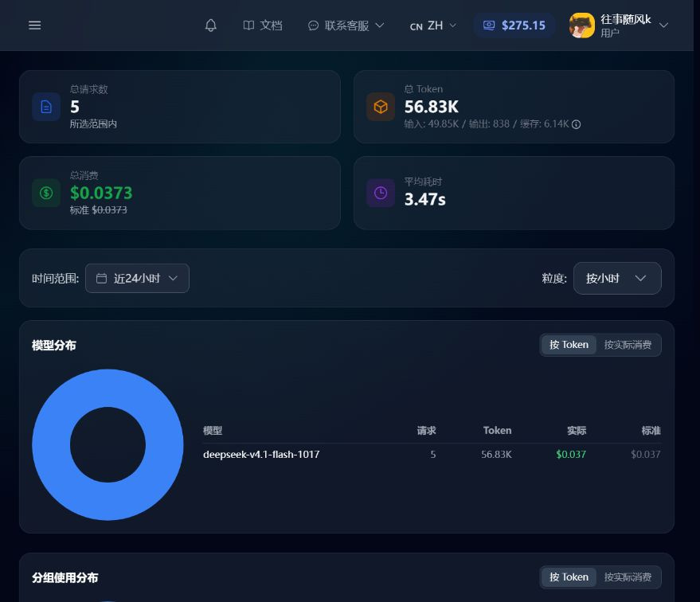

# 03. Token、余额与计费模式

[⬅️ 上一章：倍率到底是什么意思](02-multiplier.md) · [🏠 返回首页](../README.md) · [➡️ 下一章：注册到第一次请求](04-quick-start.md)

> [!TIP]
> **本章一句话看懂**：**余额**是你卡里充的钱，**Token** 是 AI 读字和写字时的计价单位（约 500 个汉字 ≈ 1000 Token）。最容易让新手不知不觉多花钱的原因是**“在一个旧对话窗口里一直聊不清空”**——学会随手点**「新建对话」**，有助于减少无关上下文；实际节省取决于客户端和模型的计费规则。

---

## 一、Token 到底是什么？（不用背公式，记住这个换算就行）

AI 模型在读你的问题和写回答时，并不是按“一个汉字”或“一个英文单词”来数的，而是把文字切成一个个小片段，每个片段就叫 **1 个 Token（词元）**。

根据 [FastAiToken 价格说明文档](https://docs.fastaitoken.com/docs/pricing)，你只需要记住这个粗略换算就够用了：

- **中文**：`1 个汉字` ≈ **1 ~ 2 个 Token**（大约 **500 个汉字 ≈ 1000 Token**）
- **英文**：`1 个单词` ≈ **1 ~ 2 个 Token**（大约 **750 个英文单词 ≈ 1000 Token**）
- **代码、标点、空格与表情符号**：也会占用 Token。

> 💡 **小贴士**：“账户余额”和“Token 数量”不是一回事！**余额是钱包里的钱**，每次对话结束后，系统会按 `本次消耗的 Token 基准费 × 分组倍率` 算出几分钱或几厘钱，再从你的余额里扣掉。

---

## 二、为什么聊得越久，每说一句话扣的钱越多？（必看省钱图解）

每次你跟 AI 对话，账单其实由两部分组成：
1. **输入 Token（Prompt / Input）**：你发给 AI 阅读的所有内容。
2. **输出 Token（Completion / Output）**：AI 写出来回复你的内容（通常**输出单价 > 输入单价**）。

很多新手会奇怪：**“我第 10 句话明明只发了‘谢谢，再改短一点’7 个字，为什么输入 Token 却显示消耗了好几千？”**

为了让模型衔接前文，客户端通常会把部分或全部历史记录作为上下文再次传入。具体携带多少，取决于客户端的历史条数限制、摘要、裁剪或压缩策略；命中缓存的部分也可能按独立价格计费。下面仅用“完整携带历史”的简化情况说明输入量为何可能增加：

```text
🟢 第 1 轮提问：只发送【第 1 问】 ─────────────────────────────────► 很便宜（只算第 1 轮）
🟡 第 2 轮提问：发送【第 1 问 + 第 1 答 + 第 2 问】 ────────────────► 第 1 轮被重新读了一遍并计费！
🔴 第 15 轮提问：发送【前 14 轮所有长文和代码 + “再改短一点”】 ─────► 历史输入量可能累积增大；实际计费还受缓存和裁剪影响。
```

### 💰 小白最管用的 3 个省钱好习惯
1. **换一个不相关的任务时，新建对话**：当前问题解决后，要问下一个不相干的问题时，务必点击客户端里的 **「新建对话（New Chat）」** 或清空上下文，斩断历史滚雪球。
2. **不要把整本书或无关大文件一股脑塞给 AI**：只粘贴需要修改的那一段文字或相关代码文件。
3. **在 Codex 等自动编程工具里分小步下指令**：让它先看单个文件或指定模块，不要一上来就让它“把整个大项目所有文件读一遍”。

---

## 三、按量计费 vs 按次计费（还有创建 Key 时的关键开关！）

根据 [FastAiToken 价格说明](https://docs.fastaitoken.com/docs/pricing)，平台支持两种计费模式：

| 计费模式 | 怎么算钱？ | 常见适用场景 |
| --- | --- | --- |
| **按量计费（按 Token）** | 根据输入和输出的 Token 数量乘以单价和倍率计算，用多少付多少。 | 日常聊天、写文章、翻译、写代码（Codex / Claude Code 等）、多模态图文理解。 |
| **按次计费（Per Request）** | 每次调用收固定或分档费用，不按字数算。 | AI 绘画生图、图片编辑、AI 视频生成（如 Seedance、可灵 Kling 等）及部分特殊模型。 |

### ⚙️ 创建 API Key 时的「令牌计费方式」怎么选？
[官方价格说明](https://docs.fastaitoken.com/docs/pricing) 列出了以下令牌计费模式。**2026-11-15 查看真实账户的「创建密钥」表单时，未见此开关**；不同版本、账户或接入方式可能有差异，不要求读者一定在当前创建窗口找到它。若你的界面有对应选项，可参考下表；没有则核对模型说明和使用记录中的实际计费模式，必要时向平台确认：

| 令牌设置选项 | 官方说明 | 给小白的选择建议 |
| --- | --- | --- |
| **默认模式** | 系统自动选择可用计费方式，**通常按次优先**。 | 如果这把 Key 主要是用来画图、生成视频，或者调用只支持按次计费的特殊模型，保持默认即可。 |
| **仅按量计费** | 即使某个模型同时支持按次计费，也会**强制使用按 Token 按量计费**。 | 如果你用这把 Key 在 Chatbox、Cherry Studio 或 Codex 里**聊文字、写代码**，希望严格按字数（Token）和倍率算钱，可以选此项或提前在价格页确认模型计费类型。 |

---

### 还要核对缓存与特殊能力的计价单位

- **缓存 Token** 可能区分写入和读取，价格可能与普通输入不同；不要把全部历史 Token 一律按普通输入价计算。
- **图片、音频、视频和工具调用** 可能按 Token、张、秒、次数或其他单位计费；不能仅凭“是视频”就断定一定按次。
- 可用渠道页面可能直接展示已经乘过分组倍率的实付价，旁边灰色小字是标价。**已折算的价格不要再乘一次倍率。**
- 当前截图和例子只展示所选账户与时间，不是永久报价；比较时同时核对计价单位、输入、输出、缓存和上下文档位。



*图：2026-11-15 的真实用量概览。输入、输出、缓存分别列出；金额为美元，示例数据不能直接预测你自己的费用。*

## 四、给新手的安心保障与预算控制法

很多第一次接触中转站的朋友会担心：“万一我充了钱不会配，或者不小心配错了把余额刷光怎么办？”

下面几项措施可以降低误配置和超支风险，但无法消除服务故障、并发结算、隐私或退款履约等全部风险：

1. **利用平台的 30 天未使用余额退款保障**：
   根据 [FastAiToken 官方价格说明](https://docs.fastaitoken.com/docs/pricing)，充值后 **30 天内，未使用余额支持无理由原路退回（微信 / 支付宝免手续费）**。即便如此，第一次依然建议只充几元钱或领体验额度先试水。
2. **给每把 API Key 戴上“额度紧箍咒”**：
   在创建 API Key 时，不要勾选“无限额度”，而是手动填一个小额度上限（比如先设 `1` 或 `2` 的额度）。当前创建表单的额度以 **USD（美元）** 表示，**`0` 代表无限制**，初次可设 `$1`。限额有助于控制风险，但并发请求或延迟结算可能导致最终金额与阈值存在差异，仍需关注账单和平台限额规则。
3. **跑 3 次典型任务就能算出你的月预算**：
   选定一个常用模型和分组后，按你平时的真实习惯用上 3~5 次，去控制台「使用记录」看一眼平均每次花几分钱，乘以你每周的使用次数，心里就彻底有数了。

---

## 下一步

理论和算钱逻辑都已经全部理清！现在我们直接动手，花 5 分钟完成从注册到发出第一条消息的全过程：

👉 **[04. 注册到第一次请求（5 分钟保姆级实操）](04-quick-start.md)**

*参考资料：[FastAiToken 价格说明](https://docs.fastaitoken.com/docs/pricing) · [平台控制台价格页](https://www.fastaitoken.com/available-channels)*
