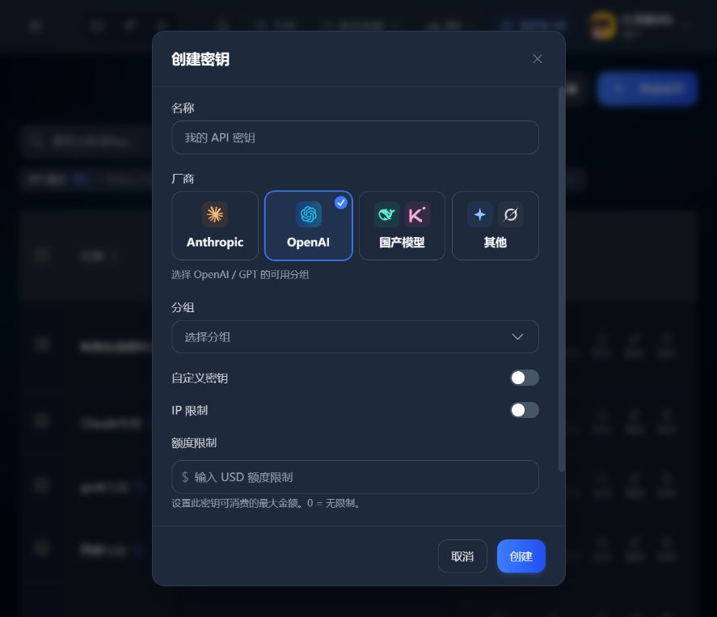
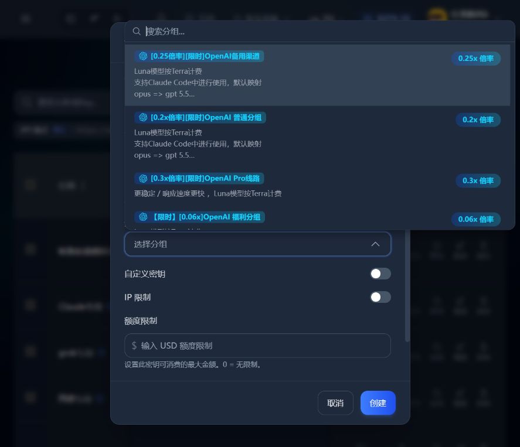
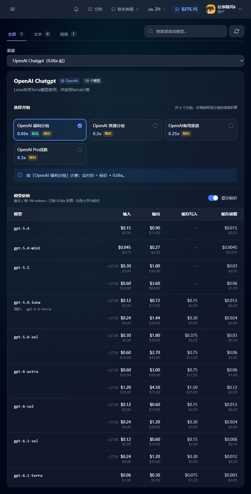
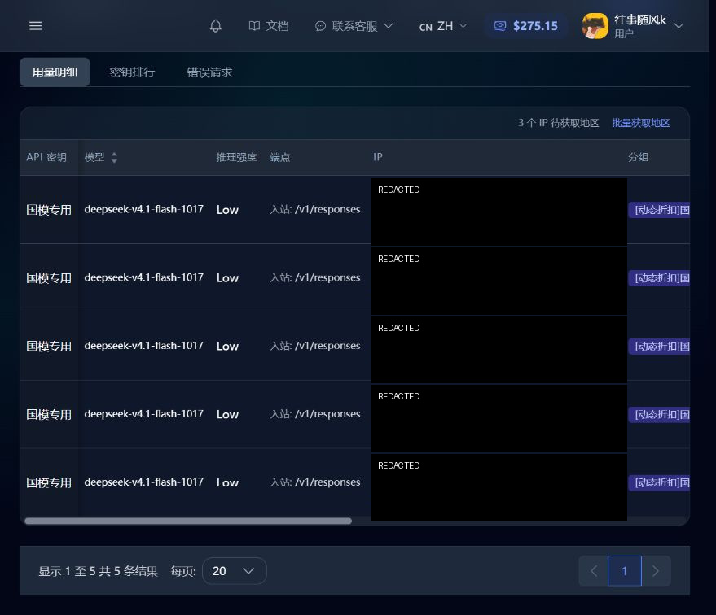
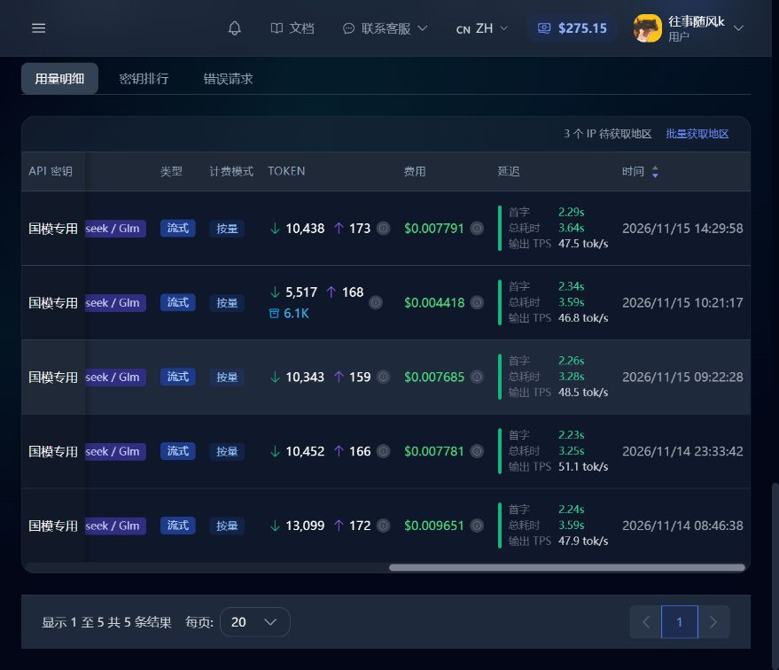

# 04. 注册到第一次请求（5 分钟保姆级实操）

[⬅️ 上一章：Token、余额与计费模式](03-billing.md) · [🏠 返回首页](../README.md) · [➡️ 下一章：OpenAI Codex 安装与使用](05-openai-codex.md)

> [!TIP]
> **本章目标**：不需要任何编程知识，带你一步步在网页控制台建好 API Key、查到正确的模型 ID，并在客户端里跑通第一句 `连接成功`！

---

## 第 1 步：注册并登录控制台

👉 **[点击这里注册 FastAiToken 账号](https://www.fastaitoken.com/register?aff=BF9KNKFHX725&utm=fastaitoken-beginner-guide)**

> *注：该链接带有推广参数 `aff=BF9KNKFHX725`，可能为本指南作者带来推广收益，不会影响你的账户价格或功能。*

- 注册并登录控制台后，**不要一上来就大额充值**。
- 你可以先准备几元钱的小额余额用于测试，或者查看 [官方文档中心](https://docs.fastaitoken.com/docs/) 说明，了解新用户注册联系工作人员领取体验额度的活动。

---

## 第 2 步：创建你的第一把 API Key（重点看表格怎么填！）

登录控制台后，点击左侧菜单进入 **[API 密钥 / 令牌页面](https://www.fastaitoken.com/keys)**，点击「添加令牌 / 创建 API 密钥」。

很多新手在这里不知道弹窗里的选项怎么填，请直接对照下面这张表设置：

| 弹窗里的设置项 | 推荐你怎么填 | 为什么要这样填？（防坑说明） |
| --- | --- | --- |
| **名称（Name）** | 写清楚给哪个软件用，比如 `我的Chatbox` 或 `电脑Codex` | 以后设备多了，一眼能看出哪把钥匙花钱多，万一泄露也能单独删掉它。 |
| **厂商（当前界面）** | 按模型选择 `OpenAI`、`Anthropic`、`国产模型` 或 `其他` | 当前表单先选厂商，再列出相应分组。 |
| **令牌分组（Group）** | **极其重要！** 选择你想用的目标分组（例如 **0.06 倍率 OpenAI 福利分组** 或 **Claude Kiro 分组**） | **分组决定了你能用哪些模型、享受几折倍率！** 如果这里没选对分组，去客户端填该分组的模型就会报 `404` 或 `403` 错误。 |
| **令牌计费方式（如果界面提供）** | 按模型需求选择，并核对实际记录 | 当前截图的创建表单未见此开关；官方规则见 [上一章](03-billing.md)，不要因此卡住创建流程。 |
| **额度（Quota）** | 当前表单输入美元金额，初次可填 `1`（`$1`）；`0` 表示无限制 | 限制单 Key 的消费范围；并发和延迟结算可能影响最终金额，仍要核对账单。 |
| **密钥有效期** | 如需临时测试，展开此项，按界面设置较短有效期 | 当前表单下方可能需要滚动，未设有效期前先核对默认行为。 |



*图 1：真实「创建密钥」窗口，已选择 OpenAI。本次只查看表单，没有提交创建；“额度限制”下方明确写着 `0 = 无限制`。下方设置可能需在窗口内滚动查看。*



*图 2：展开分组后的真实选项。名称、倍率和支持范围会变化；分组描述与模型表不一致时，先小额验证或咨询平台，不凭旧截图判断权限。*

创建成功后，列表通常只显示以 **`sk-`** 开头的部分字符：
- **立刻点击「复制」**，把它保存到可信的密码管理器或本机安全位置，避免自动同步到公开笔记；
- ⚠️ **注意**：本教程后面出现的 `sk-your-key` 都只是举例占位符，你实际填写时必须换成你自己刚刚复制的这串 `sk-...`！

---

## 第 3 步：去控制台复制准确的“模型 ID”（千万别手打！）

这是新手最容易报错（`404 model_not_found`）的一步！

1. 在控制台左侧找到 **「可用渠道」** 或 **「模型广场 / 价格说明」** 页面；
2. 先筛选你刚才在第 2 步里为 API Key 选定的那个 **分组**；
3. 找到你想用的模型，确认它的**输入/输出、缓存单价和倍率**，点击模型名旁的**复制模型 ID**按钮。注意页面可能已将价格按分组倍率折算，不要重复乘倍率。



*图 3：真实「可用渠道」页。先选择渠道，再选择分组；模型名旁的小按钮用于复制 ID。页面同时显示折算价、灰色标价和缓存价，图中价格仅代表截图时的界面。*

> [!WARNING]
> **为什么不能自己凭印象手打模型名？**
> 因为网页海报或文章里写的往往是好记的展示名（比如 `GPT-5.6 Sol`、`GPT-6.1 Sol`、`Claude Fable 5`），而程序接口认识的“模型 ID”通常对大小写、连字符 `-` 和版本号要求极其严格（例如 [官方简易使用文档](https://docs.fastaitoken.com/docs/easyuse) 示例中填写的 ID 是全小写的 `gpt-6.1-sol`）。差一个空格或大小写，软件就会提示找不到模型！

---

## 第 4 步：把“三要素”填进你的客户端软件

打开你常用的 AI 软件（如果你用的是终端里的 OpenAI Codex，请直接跳到 [第 05 章 Codex 专章](05-openai-codex.md)；如果你用的是 Chatbox、Cherry Studio 等聊天软件，也可以配合 [第 06 章客户端配置](06-client-config.md) 一起看），在设置里填入这三项：

| 软件设置项名称 | 你应该填入的内容 |
| --- | --- |
| **接口类型 / Provider** | 选择 `OpenAI` 或 `OpenAI 兼容 (OpenAI Compatible)` |
| **API 地址 / Base URL / API Host** | 填 `https://www.fastaitoken.com/v1`<br>*(注：如果软件输入框底下有一行小字预览显示它会自动帮你加上 `/v1/chat/completions`，那你只需填 `https://www.fastaitoken.com`，总之最终预览地址不能变成 `/v1/v1`)* |
| **API 密钥 / API Key** | 粘贴你在第 2 步复制的 `sk-...`（检查头尾不要多带空格） |
| **模型 / Model ID** | 粘贴你在第 3 步从控制台复制的准确模型 ID |

---

## 第 5 步：发送“最小测试”并核对账单（验明正身）

保存设置后，新建一个空白对话，第一句话**不要发长篇大论**，只发送下面这 8 个字：

```text
请只回复：连接成功
```

如果几秒钟内 AI 乖乖回复了“连接成功”，恭喜你，网络和密钥已经完全打通了！

紧接着，请回到 FastAiToken 网页控制台，点开 **「使用记录 / 调用日志」** 看一眼刚刚这一条记录：
- [x] **调用的模型 ID** 是不是你选的那一个？
- [x] **分组与倍率** 是不是你预期的优惠倍率（例如 `0.06`）？
- [x] **扣费金额** 是不是只有极小的几厘/几分钱？

这几项符合预期后，再逐步扩大使用量；模型、倍率和账单后续仍需定期核对。



*图 4：使用记录的左侧可核对模型 ID、端点和分组。IP 地址已实色遮挡；API 密钥列显示的是用途名称，不是密钥字符串。窄窗口需横向滚动。*



*图 5：向右滚动同一张表后，可核对「按量」、输入/输出及缓存 Token、费用和时间。此处为既有真实记录，未为截图额外发起付费调用。*

---

<details>
<summary>🔧 <b>进阶可选：手头还没安装任何客户端？点此展开「用 Windows 自带 PowerShell 测试连接」</b></summary>

如果你电脑上还没装 Chatbox 或 Codex，只是想先测试一下刚才创建的 API Key 能不能用，可以按 `Win + R` 输入 `powershell` 打开终端，把下面代码里的 `sk-your-key` 和 `your-model-id` 换成你自己的真实值，复制进去回车运行：

```powershell
$env:FASTAI_API_KEY = "sk-your-key"
$body = @{
  model = "your-model-id"
  messages = @(
    @{ role = "user"; content = "请只回复：连接成功" }
  )
} | ConvertTo-Json -Depth 5

Invoke-RestMethod `
  -Uri "https://www.fastaitoken.com/v1/chat/completions" `
  -Method Post `
  -Headers @{ Authorization = "Bearer $env:FASTAI_API_KEY" } `
  -ContentType "application/json; charset=utf-8" `
  -Body ([System.Text.Encoding]::UTF8.GetBytes($body))
```

看到屏幕返回包含 `连接成功` 的结果即代表一切正常。测试完后直接关掉这个 PowerShell 窗口即可。
</details>

---

## 下一步去哪？

- 想在电脑上用 **OpenAI Codex** 自动读项目、写代码、改文档？👉 看 **[05. OpenAI Codex 安装与使用（含一键导入与防坑命令）](05-openai-codex.md)**
- 想在电脑或手机上用 **Chatbox、Cherry Studio、沉浸式翻译**？👉 看 **[06. Chatbox 与其他客户端配置](06-client-config.md)**
- 发送测试时弹出了红色报错提示？👉 看 **[07. 常见报错 10 秒速查与排查](07-troubleshooting.md)**

*参考资料：[FastAiToken 零基础简易使用](https://docs.fastaitoken.com/docs/easyuse) · [快速开始](https://docs.fastaitoken.com/docs/getting-started) · [API 手册](https://docs.fastaitoken.com/docs/api-manual)*
