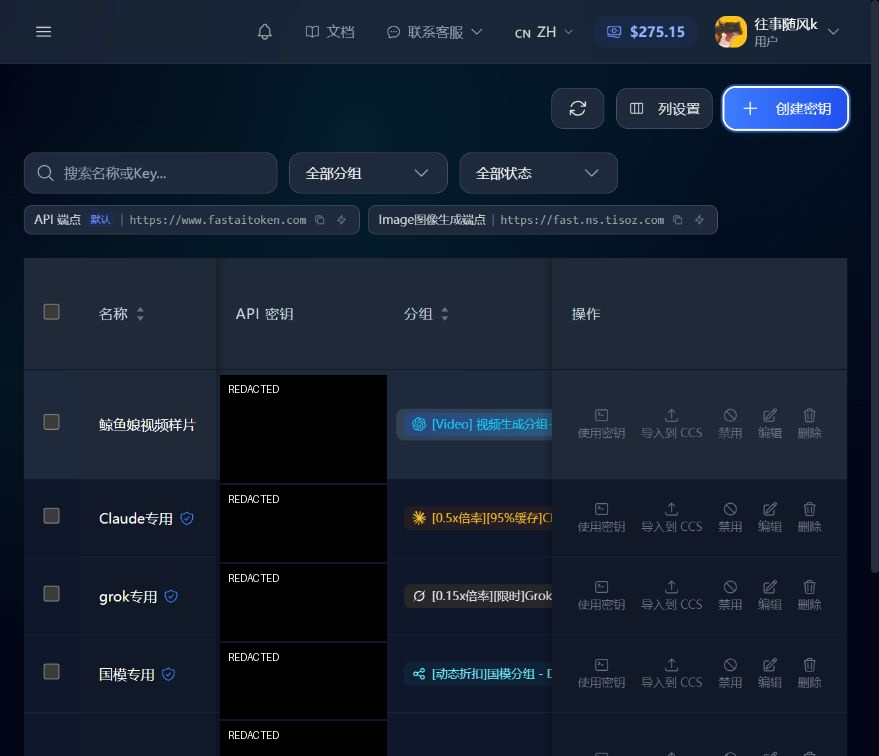

# 05. OpenAI Codex 安装与使用（Windows 零基础避坑版）

[⬅️ 上一章：注册到第一次请求](04-quick-start.md) · [🏠 返回首页](../README.md) · [➡️ 下一章：Chatbox 与其他客户端配置](06-client-config.md)

> [!TIP]
> **本章一句话看懂**：Codex 是能在你电脑文件夹里直接帮你读文档、改代码、跑命令的 AI 助手。让它连接 FastAiToken 有两个最核心的秘诀：
> 1. 它的地址填 **`https://www.fastaitoken.com`（末尾不带 `/v1`）**，协议填 `wire_api = "responses"`；
> 2. **千万别掉进 Windows 记事本隐藏 `.txt` 后缀名的坑**——本章直接给你准备了**“CC Switch 一键导入法”**和**“PowerShell 复制粘贴一键生成配置文件法”**，帮助减少手动建文件的错误；连接是否成功仍需实际测试。

---

## 一、前期准备：安装 Node.js 与 Codex

> [!NOTE]
> Codex 更新很快。以下安装流程基于当前公开资料与 [FastAiToken 简易使用文档](https://docs.fastaitoken.com/docs/easyuse)；如果后续官方更新了命令，请结合 [OpenAI Codex 官方文档](https://developers.openai.com/codex/) 核对。

### 1. 检查或安装 Node.js
Codex CLI 需要依赖电脑上的 Node.js 环境。按键盘 `Win + X`，选择打开 **终端 (PowerShell)**，输入下面两行命令并回车：

```powershell
node --version
npm --version
```

- 如果分别显示出了版本号（如 `v20.x.x` 或 `v22.x.x`），说明已经装好了，直接跳到第 2 小步！
- 如果提示“找不到命令 / 不是内部或外部命令”，请先打开 [Node.js 官网](https://nodejs.org/) 下载并安装左侧标有 **LTS（长期支持版）** 的安装包，一路点 Next 装完后，**关掉终端重新打开**。

### 2. 一行命令安装 Codex CLI
在 PowerShell 窗口中运行：

```powershell
npm install -g @openai/codex
```

> 💡 **Windows 常见小插曲**：如果屏幕上冒出红字提示 `无法加载文件 ... npm.ps1，因为在此系统上禁止运行脚本`，完全不用慌！改用下面这行带 `.cmd` 的命令即可直接绕过限制：
> ```powershell
> npm.cmd install -g @openai/codex
> ```

安装完成后，输入 `codex --version` 能看到版本号，就说明软件装好了（**此时先不用打开运行它，我们先配钥匙！**）。

---

## 二、把 FastAiToken 钥匙配给 Codex（二选一，推荐方法 A 或方法 B 一键生成！）

要把 Codex 连上 FastAiToken，你有两种办法可选：

### 🌟 方法 A：用 CC Switch 软件一键导入（最适合讨厌改配置文件的纯小白）

根据 [FastAiToken 官方零基础简易使用教程](https://docs.fastaitoken.com/docs/easyuse)，如果你电脑上安装了 **CC Switch (`cc-switch`)** 助手工具：

1. 登录 FastAiToken 控制台的 [API 密钥页面](https://www.fastaitoken.com/keys)；
2. 在你创建好的密钥右侧操作栏里，点击 **「导入到 CCS」**（部分旧版本显示为 `ccs`）；
3. 按 CC Switch 提示核对目标工具、地址和模型，再完成导入。导入后仍需重启 Codex 并进行只读测试；已有配置先在 CC Switch 中确认备份和切换行为。



*图：2026-11-15 的真实账户页面。Key 一列已实色遮挡；右侧可见「导入到 CCS」。窄窗口可横向滚动表格查看操作列。*

---

### 🛠️ 方法 B：生成 `.codex` 配置文件（通用标准做法）

如果你不用 CC Switch，Codex 默认会去你电脑用户目录下的 `.codex` 文件夹（路径通常是 `C:\Users\你的电脑用户名\.codex\`）里读取两个文件：
- **`auth.json`**：存放你的 `sk-` 密钥；
- **`config.toml`**：存放 FastAiToken 的地址和你要用的模型 ID。

> [!CAUTION]
> **Windows 上的一种常见问题：隐藏的 `.txt` 后缀名。**
> 很多新手在文件夹里右键“新建 → 文本文档”，然后把名字改成 `auth.json` 和 `config.toml`。但因为 Windows 默认开启了“隐藏已知文件类型的扩展名”，这两个文件在系统底层的真实名字其实变成了 **`auth.json.txt`** 和 **`config.toml.txt`**！这会让 Codex 无法读取对应配置，可能表现为仍要求官方登录；也要检查配置目录、所选服务商和配置解析错误，不能仅凭登录提示认定原因。

下面的命令可以减少手动创建文件时的后缀名和编码错误。**首次配置可用 B1；已经用过 Codex 的读者应先阅读已有配置的保护说明，再按 B2 合并。**

#### 👉 方式 B1：PowerShell 安全创建配置（已有配置会备份并停止）

先关闭正在运行的 Codex。把下面前两行的 `sk-your-key` 和 `your-current-model-id` 换成自己的真实值，再整段复制到 PowerShell。

> [!IMPORTANT]
> **保护已有配置**：脚本检查 `auth.json` 和 `config.toml`。只要其中任一个已存在，就复制现有文件到同目录下带时间和随机编号的备份文件夹，然后停止，**不会覆盖原文件**。看到停止提示后，请按 B2 手动合并；不要为了让脚本继续而删除原配置。
>
> 默认目录为用户目录下的 `.codex`；如果你设置过 `CODEX_HOME`，脚本会使用该目录。备份中也可能含真实 Key，只留在可信本机，不要上传或截图公开。脚本写出两个文件不代表服务已经连接成功；如遇磁盘或权限错误而只写出一个文件，请先核对文件，保留已有内容并按 B2 继续。

```powershell
$ErrorActionPreference = 'Stop'
$MyApiKey = 'sk-your-key'
$MyModelId = 'your-current-model-id'

if ($MyApiKey -eq 'sk-your-key' -or $MyApiKey -notmatch '^sk-[A-Za-z0-9_-]+$') {
  throw 'Replace sk-your-key with your API key before running.'
}
if ($MyModelId -eq 'your-current-model-id' -or $MyModelId -notmatch '^[A-Za-z0-9][A-Za-z0-9._:/-]*$') {
  throw 'Replace your-current-model-id with the exact model ID from the console.'
}

$CodexDir = if ([string]::IsNullOrWhiteSpace($env:CODEX_HOME)) {
  Join-Path $env:USERPROFILE '.codex'
} else {
  $env:CODEX_HOME
}
$CodexDir = [System.IO.Path]::GetFullPath($CodexDir)
New-Item -ItemType Directory -Force -Path $CodexDir | Out-Null
$FileNames = @('auth.json', 'config.toml')
$ExistingFiles = @($FileNames | Where-Object { Test-Path -LiteralPath (Join-Path $CodexDir $_) })

if ($ExistingFiles.Count -gt 0) {
  $BackupName = 'backup-before-fastai-' + (Get-Date -Format 'yyyyMMdd-HHmmss') + '-' + [guid]::NewGuid().ToString('N')
  $BackupDir = Join-Path $CodexDir $BackupName
  New-Item -ItemType Directory -Path $BackupDir | Out-Null
  foreach ($FileName in $ExistingFiles) {
    $SourceFile = Join-Path $CodexDir $FileName
    if (-not (Test-Path -LiteralPath $SourceFile -PathType Leaf)) {
      throw "Expected a file: $SourceFile. No configuration was replaced."
    }
    Copy-Item -LiteralPath $SourceFile -Destination (Join-Path $BackupDir $FileName) -ErrorAction Stop
  }
  Write-Host "Backup created: $BackupDir"
  throw 'Existing configuration detected. Original files were preserved. Merge changes manually using method B2.'
}

$AuthContent = @{ OPENAI_API_KEY = $MyApiKey } | ConvertTo-Json
$ConfigContent = @"
model_provider = "custom"
model = "$MyModelId"
model_reasoning_effort = "high"
disable_response_storage = true

[model_providers.custom]
name = "fastaitoken"
base_url = "https://www.fastaitoken.com"
wire_api = "responses"
requires_openai_auth = true
"@

$Contents = @{ 'auth.json' = $AuthContent; 'config.toml' = $ConfigContent }
$Utf8NoBom = New-Object System.Text.UTF8Encoding($false)
foreach ($FileName in $FileNames) {
  $FilePath = Join-Path $CodexDir $FileName
  $FileStream = [System.IO.File]::Open($FilePath, [System.IO.FileMode]::CreateNew, [System.IO.FileAccess]::Write)
  try {
    $FileBytes = $Utf8NoBom.GetBytes($Contents[$FileName])
    $FileStream.Write($FileBytes, 0, $FileBytes.Length)
  } finally {
    $FileStream.Dispose()
  }
}
Write-Host "Configuration files created: $CodexDir"
Write-Host 'Restart Codex, then verify the model and usage record. File creation alone does not prove a working connection.'
```

看到 `Configuration files created` 只表示文件写入成功。重启 Codex 后，按第四节做只读测试，并到平台核对模型和扣费。如果看到 `Existing configuration detected`，原文件保持不变，备份路径在上一行 `Backup created` 后面；如果备份本身失败，先解决权限或磁盘问题，不要继续改配置。

---

#### 👉 方式 B2：我想自己打开文件夹手动创建/查看文件

如果你习惯自己打开文件夹查看或修改：

> [!WARNING]
> **已有用户先备份、再合并。** 关闭 Codex，把现有 `auth.json`、`config.toml` 复制到可信本机的独立备份目录；只改需要的模型、认证和服务商字段，保留其他设置。下面是首次配置的完整示例，不能直接覆盖你原来的整份配置。已有 `custom` 服务商时，先确认它是否可替换；如需并存，用不同的服务商标识并让 `model_provider` 指向相应配置。要回退时，关闭 Codex，确认目标目录，再恢复自己这次操作前的备份。

1. 在 PowerShell 里输入下面这行命令回车，会直接弹出 `.codex` 文件夹窗口（如果提示不存在，先建一个名为 `.codex` 的文件夹）：
   ```powershell
   explorer.exe "$env:USERPROFILE\.codex"
   ```
2. **先开启显示文件扩展名**：在文件夹顶部菜单点击 **「查看」→「显示」→ 勾选「文件扩展名」**（Windows 10 在顶部「查看」选项卡勾选「文件扩展名」），确保你能亲眼看到文件的真实后缀。
3. 检查或创建 **`auth.json`**（确认不是 `auth.json.txt`），内容如下：
   ```json
   {
     "OPENAI_API_KEY": "sk-这里换成你在FastAiToken创建的密钥"
   }
   ```
4. 检查或创建 **`config.toml`**（确认不是 `config.toml.txt`），内容如下（参考 [FastAiToken 简易使用文档](https://docs.fastaitoken.com/docs/easyuse)）：
   ```toml
   model_provider = "custom"
   model = "gpt-6.1-sol"
   model_reasoning_effort = "high"
   disable_response_storage = true

   [model_providers.custom]
   name = "fastaitoken"
   base_url = "https://www.fastaitoken.com"
   wire_api = "responses"
   requires_openai_auth = true
   ```
   *(注：请把 `model = "gpt-6.1-sol"` 里的模型 ID 换成你在控制台当前所选分组下实际可用的模型 ID，如 `GPT-5.6 Sol` / `GPT-5.6 Terra` 等对应的真实 ID。)*

---

## 三、为什么这里的 `base_url` 不带 `/v1`？（一句话解惑）

细心的你一定会发现：前面讲普通聊天软件时填的是 `https://www.fastaitoken.com/v1`，为什么这里 Codex 的 `config.toml` 里只写 `https://www.fastaitoken.com`？

- 这是 **FastAiToken 当前 Codex 配置示例的写法**，配置使用 `wire_api = "responses"`；不要据此推断所有 Responses 客户端或所有服务商都应去掉 `/v1`，其他接入方式应核对各自文档和实际端点。
- **你只需要记住结论**：
  - 配 **Codex (`config.toml`)** 👉 照抄上面的 **`https://www.fastaitoken.com`（不带 `/v1`）**；
  - 配 **Chatbox / Cherry Studio 等普通聊天软件** 👉 填 **`https://www.fastaitoken.com/v1`（带 `/v1`）**。

---

## 四、第一次运行 Codex 怎么安全试水？

Codex 拥有读写你当前文件夹和运行命令的能力，所以**第一次千万不要直接在你最重要的孤本文件目录里让它乱删乱改**！

1. 先新建一个专门用来测试的文件夹（或者进入一个已经有 Git 备份的项目目录）：
   ```powershell
   cd "C:\你的测试文件夹路径"
   codex
   ```
2. 启动后，第一句话先让它做**“只看不改”**的安全动作：
   ```text
   请先只读取当前文件夹里的 README 文件，用三句话总结它的内容，不要修改任何文件。
   ```
3. 确认它能流畅回答，并且你在 FastAiToken 控制台「使用记录」里看到的扣费和倍率都符合预期后，再让它帮你干活！

### 🛡️ 用 Codex 干活的 3 条安全习惯
- **重要文件先备份**：如果文件夹没有用 Git 管理，让 Codex 大改之前先手动复制一份文件夹备份。
- **先看计划再放行**：遇到不确定的大改动，可以先对它说：`先告诉我你打算改哪些文件、怎么改，等我确认后再动手`。
- **以后想换模型怎么办？**：只需去控制台复制新的模型 ID，打开 `C:\Users\你的用户名\.codex\config.toml`，把 `model = "..."` 双引号里的名字换掉保存，重启 Codex 即可。

---

## 五、Codex 常见卡点速查

| 你遇到的问题 | 常见原因与建议检查顺序 |
| --- | --- |
| **一打开 `codex` 还是跳出浏览器让我登录 OpenAI 官方账号** | 检查文件真实扩展名、实际配置目录（含自定义 `CODEX_HOME`）、`model_provider` 与服务商段是否对应，以及启动时是否提示 JSON/TOML 解析错误。先备份，再按 B2 修正命中的问题；不要仅凭登录提示重建整份配置。 |
| **报错 `404` 或提示模型不存在 (`model_not_found`)** | `config.toml` 里的 `model = "..."` 填成了宣传名，或者你这把 API Key 绑定的**分组**不支持该模型。去控制台复制准确的模型 ID 并检查令牌分组。 |
| **报错请求地址错误 / 路径不对** | 检查 `config.toml` 里是不是误加上了 `/v1`，确认写成 `base_url = "https://www.fastaitoken.com"` 且 `wire_api = "responses"`。 |
| **报错 `401 invalid_api_key`** | `auth.json` 里的 `sk-` 密钥没换，或者不小心多复制了空格、把英文双引号 `"` 改成了中文双引号 `“`。 |

更多错误代码请看 [07. 常见报错排查](07-troubleshooting.md)。

*参考资料：[FastAiToken 零基础简易使用（Codex 与 CC Switch）](https://docs.fastaitoken.com/docs/easyuse) · [OpenAI Codex 官方文档](https://developers.openai.com/codex/)*
